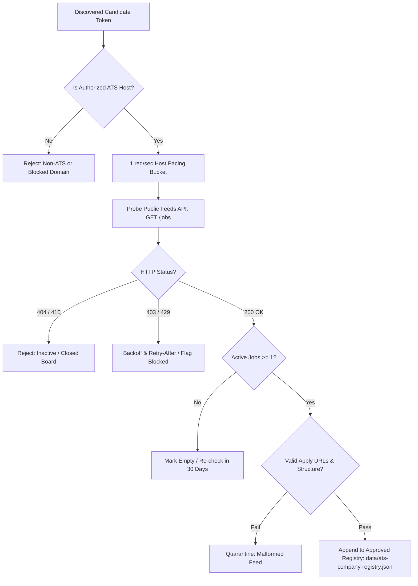

# CareerMonke ATS Employer Expansion Discovery Plan
**Target Horizon**: ~1,000 Verified Employers / ~10,000 Active Unique Jobs (Operational Targets, Not Guarantees)
**Status**: READ-ONLY DISCOVERY PLAN (Step 1 — Zero Production Writes, Zero Workflow Dispatch)
**Database Migration**: `SQL NOT REQUIRED` (The current PostgreSQL schema in Supabase already contains all required columns: `source_type`, `discovered_at`, `consecutive_misses`, `is_active`, `remote_scope`, `remote_eligibility`, `salary_min`, `salary_max`, `currency`, `salary_period`).

---

## 1. Objectives & Guiding Principles

1. **Grow Legitimate Supply**: Expand from the current 52-employer daily seed toward the 277 verified registry employers, with an eventual target horizon of 1,000 verified employers and ~10,000 active unique jobs. These figures are operational scaling targets, not commercial promises.
2. **Strictly Direct ATS Ingestion**: Ingest strictly from public, unauthenticated ATS APIs (Greenhouse, Lever, Ashby, Workable, SmartRecruiters, Recruitee, Breezy, Teamtailor, Personio) where jobs are hosted directly on behalf of employers.
3. **Zero Third-Party Scraping**: Maintain strict zero-scraping locks against LinkedIn, Indeed, Naukri, Glassdoor, Workday, JobSpy, and Jobright.
4. **Attribution & Licensing Discipline**: Public API accessibility is **not** a blanket republication license. Every source candidate must have verified provenance, clear rights, and acceptable terms.
5. **No Shortcut Aggregators**: Free scale shortcuts like Adzuna, Jooble, or Remotive are explicitly forbidden due to conflicting terms, commercial licensing, or signup walls.

---

## 2. Incompatible Sources Audit & Flagging

The existing repository configuration was audited for sources that conflict with CareerMonke licensing, terms, or republication policies. **In accordance with safety locks, production configuration is flagged here without silently altering production data:**

| Source Identifier | File Location | Conflict Reason | Action Required / Policy |
|---|---|---|---|
| `api-remotive` | `scripts/config/sources.json` | Remotive enforces signup-wall restrictions and developer API usage limits that conflict with unauthenticated open job discovery. | **FLAGGED**: Do NOT expand or rely on Remotive for scale. Keep existing runs bounded; omit from approved ATS expansion set. |
| `adzuna.ts` | `scripts/adapters/adzuna.ts` | Adzuna requires commercial API licensing, strict attribution badges, and referral tracking that conflict with clean ATS-direct linking. | **FLAGGED**: Do NOT use Adzuna as an ATS scale shortcut. Ingestion must remain strictly employer-direct. |
| `jooble` | N/A (Evaluated) | Scraping or unofficial API usage violates Jooble Terms of Service; commercial tier requires fee and affiliate tracking. | **BLOCKED**: Excluded from pipeline. |

---

## 3. Approved Candidate Discovery Streams & Provenance

To grow the approved registry from 277 toward 1,000 employers, discovery reuses verified, license-checked streams recorded in `SOURCES.md`:

### Stream A: Common Crawl Public URL Index (CDX API)
- **Provider**: Common Crawl Foundation (501(c)(3) registered non-profit)
- **Index**: `CC-MAIN-2026-43` via `https://index.commoncrawl.org/`
- **Methodology**: Search line-delimited CDX records for public ATS domain patterns:
  - `boards.greenhouse.io/*`
  - `jobs.lever.co/*`
  - `jobs.ashbyhq.com/*`
  - `apply.workable.com/*`
  - `*.smartrecruiters.com/*`
  - `*.recruitee.com/*`
  - `*.breezy.hr/*`
  - `*.personio.de/*` & `*.personio.com/*`
- **Cursor Persistence**: Store crawl index offset and CDX page cursors in `reports/discovery-cursor-commoncrawl.json`.
- **Extraction**: Extract organization token from subdomain or path segment; normalize to lowercase slug.

### Stream B: Open-Source MIT-Licensed Token Registries (GitHub)
- **Dataset 1**: `Feashliaa/job-board-aggregator` (MIT License, Copyright (c) 2026 Riley Dorrington)
  - Provides candidate tokens for Greenhouse, Lever, Ashby, BambooHR.
- **Dataset 2**: `AkshatBhat/find-companies-using-ashby-job-boards` (MIT License, Copyright (c) 2026 Akshat Bhat)
  - Provides candidate slugs and company name mappings for Ashby.
- **Attribution & Rights**: Verified MIT license headers preserved. Tokens represent publicly accessible organization endpoints.

### Stream C: Unverified Employer Probing (`company_probe`)
- **Policy**: OFF by default (`--probe` flag required).
- **Restriction**: Restricted strictly to established platforms (Greenhouse, Lever, Ashby). Never probe Workable, Breezy, or BambooHR.
- **Verification Rule**: Guessed tokens are never added to `data/ats-company-registry.json` or ingested into the database without passing live public API verification (HTTP 200 with `>= 1` active job).

---

## 4. Live Board Verification & Qualification Gate

Every candidate token discovered through Streams A, B, or C must pass an automated qualification gate before inclusion into `data/ats-company-registry.json`:



### Acceptance Criteria for Approved Registry:
1. HTTP 200 response on canonical public JSON/XML feed.
2. At least 1 active job listing returned.
3. Employer apply URL is HTTPS and points directly to the ATS or employer career domain.
4. ATS type is supported by an existing normalized adapter in `scripts/adapters/`.
5. Company name cleanly resolved without HTML entities or tracking parameters.

---

## 5. Safe Per-Board Ingestion Lifecycle & Retention Rules

To protect production data integrity, CareerMonke implements strict per-board lifecycle rules:

1. **Consecutive Miss Counting (`consecutive_misses`)**:
   - When an existing job is absent from a successful board fetch:
     - Miss 1: Increment `consecutive_misses = 1`. **Job remains `is_active = true`** (accommodates temporary feed glitches or short maintenance windows).
     - Miss 2: Set `is_active = false` and `status = 'expired'`.
2. **Protection Against Partial / Failed Runs**:
   - If a board fetch fails (HTTP 5xx, network timeout, rate limit 429), **zero miss increments are performed**.
   - If a run is interrupted, capped by runtime budget, or partially paginated, **no jobs are deactivated**.
   - Jobs are only marked expired if the board fetch was `complete` and returned a valid job list.
3. **No Broad Deletes**:
   - Blanket `DELETE FROM jobs` queries are strictly prohibited in application and ingestion code.
   - Permanent purge is restricted to jobs where `is_active = false` and `last_seen_at < NOW() - INTERVAL '14 days'`.

---

## 6. Sizing, Rate Pacing, and Database Headroom

### Rate Pacing & Politeness:
- **Pacing**: Strictly 1 request per second per host domain (`MIN_DOMAIN_INTERVAL_MS = 1000`).
- **Concurrency**: Bounded concurrency pool (max 3 concurrent host domains).
- **User-Agent**: Strictly `CareerMonkeBot/1.0 (https://careermonke.com; ingestion-ops@careermonke.com)`.
- **429 Handling**: Exponential backoff with jitter, honoring `Retry-After` headers up to 60s.

### Capacity & Database Sizing:
- **Average Job Row Size**: ~2.5 KB (2,560 bytes) including indexed search vectors and structured compensation.
- **Estimated Database Footprint**:
  - Current Seed (52 boards, ~800 jobs): **~2.0 MB**
  - Full Existing Registry (277 boards, ~4,000 jobs): **~10.0 MB**
  - Target Scale (1,000 boards, ~10,000 jobs): **~25.0 MB**
- **Safety Ceiling**: **150.0 MB** maximum database growth per ingestion run. The pipeline automatically halts if growth exceeds this safety limit.
- **Runtime Budget**:
  - 277 boards at 1 req/s paced across 3 ATS hosts: ~120–180 seconds.
  - 1,000 boards paced: ~500–700 seconds (~10 minutes).

---

## 7. Owner-Approved Rollout & Rollback Playbook

### Step 1: Read-Only Dry-Plan Verification (Current Step — Zero DB Writes)
Run the dry-plan engine to audit the existing registry without writing any database rows:
```bash
# Audit full 277 registry employers in dry-plan mode (read-only)
npx tsx scripts/ats-dry-plan.ts --source registry --resume
```

### Step 2: Owner-Approved Phased Production Rollout (Future Step)
Upon explicit repository owner instruction and review of dry-plan reports:
```bash
# Phase 2A: Test-run first 20 registry boards in production insert-only mode
npx tsx scripts/board-ingest.ts --mode production --source-mode registry --limit 20

# Phase 2B: Full registry production ingestion
npx tsx scripts/board-ingest.ts --mode production --source-mode registry
```

### Rollback Playbook:
If any unexpected data anomaly occurs during live ingestion:
1. Every live ingestion run generates an atomic rollback script tied to its exact `discovered_at` ISO timestamp:
   `reports/rollback-ingest-<discovered_at>.sql`
2. The rollback SQL isolates the affected batch without touching prior job inventory:
   ```sql
   -- Atomic Rollback for Ingestion Batch
   DELETE FROM jobs
   WHERE discovered_at = '<discovered_at>'
     AND source_type = 'ats';
   ```
3. Run verification query to confirm inventory restoration:
   ```sql
   SELECT count(*), source_type, max(discovered_at)
   FROM jobs
   GROUP BY source_type;
   ```

---

## 8. Database Migration Declaration

**`SQL NOT REQUIRED`**

The existing PostgreSQL table `jobs` and associated views (`jobs_public`) already contain all necessary columns, constraints, and indices:
- `source_type` (`text` / `'ats'`)
- `discovered_at` (`timestamptz`)
- `consecutive_misses` (`integer DEFAULT 0`)
- `is_active` (`boolean DEFAULT true`)
- `remote_scope` (`text`)
- `remote_eligibility` (`text`)
- `salary_min`, `salary_max`, `currency`, `salary_period` (`numeric`, `text`)

No DDL migrations, table alterations, or index creations are needed.
